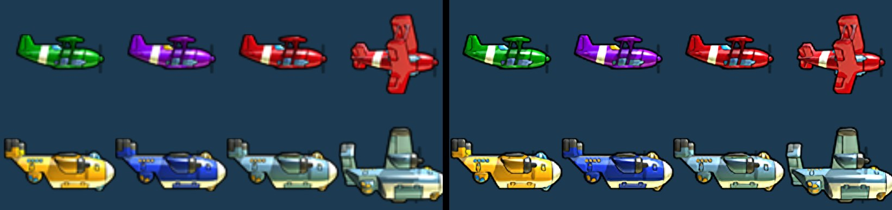
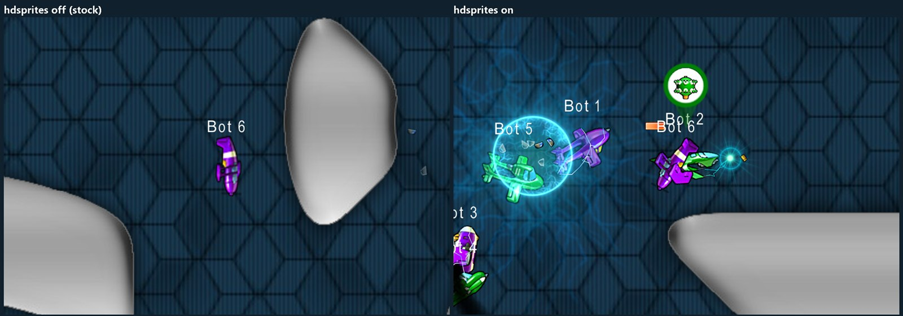

# Altitude 1.1.9 REMASTERED

A patched client for [Altitude](https://store.steampowered.com/app/41300/Altitude/) 1.1.9 that makes the game look
right on today's screens: HD sprites, sharp HUD text at any resolution, a resizable window and a clearer ball-mode
score, plus faster map loading. Gameplay, networking and the server are unchanged, so it plays on every normal server
alongside stock players, and it gives no gameplay advantage: everything you see is the same game art, just with more
pixels.





**Status: beta.** Please [report](../../issues/new/choose) anything that looks or feels wrong.

## Install

Download the latest bundle from [Releases](../../releases) (`Altitude-REMASTERED-<build>.zip`), extract it, close
Altitude, and in the extracted folder run:

```
powershell -ExecutionPolicy Bypass -File .\remastered.ps1
```

It finds Altitude through Steam, copies two files into the game's `app\lib` folder, and points the game's launcher at
the new jar (keeping a backup). Then start Altitude from Steam as usual. To remove it, run the same command with
`-Uninstall`. Steam's "Verify integrity of game files" also undoes it. The stock game files are never changed.

Installing by hand instead: copy `Altitude-1.1.9-REMASTERED.jar` and `Altitude-1.1.9-hdsprites.zip` into
`<Altitude>\app\lib\`, and in `<Altitude>\app\Altitude.cfg` change the first `app.classpath=` line to
`app.classpath=$APPDIR\lib\Altitude-1.1.9-REMASTERED.jar`.

## What it changes

Type `/opt` in the game console to see every option and the build ID; `/opt NAME` explains one, `/opt NAME on|off`
changes it.

| | Option | Default |
|---|---|---|
| **HD sprites**: planes in every team colour, skins, bases, turrets, powerups, projectiles and effects, upscaled 3x (225 textures), used at the scale your window needs | `hdsprites` | on |
| **Sharp HUD text**: fonts drawn at your screen's resolution instead of scaled-up bitmaps, same size and place | `stockfonts` | off (so sharp) |
| **Resizable window**: drag windowed mode to any size or maximise it | `window` | resizable |
| **Ball-mode score**: a backing so the score reads on any background, and the sudden-death target ("to 8") | `scorehud` | on |
| **Faster map loading**: map images decoded in the background, game art preloaded in the menu | – | always |
| **Frame pacing**: steadier frame times, at a CPU cost; [please try it](TESTERS.md#please-test-frame-pacing-off-by-default) | `framepacing` | off |
| **Perf overlay and log**: frame times, GC pauses, ping, for bug reports | `perfhud`, `perflog` | off |

Good to know:

- HD sprites need about 340 MB of disk for their cache at 1080p and 1440p, 740 MB at 4K (in
  `%LOCALAPPDATA%\NimblyGames\Altitude\config\client-sprites-cache`). Below 720p the game uses the stock sprites.
- Resizing the window across those sizes reloads the textures once, with a short freeze (under a second).
- Only the official HD sprite pack from a release is accepted, so the art cannot be swapped for see-through or
  high-contrast versions.
- So far it has been tested on NVIDIA graphics only. Reports from AMD and Intel graphics are very welcome.

## Reporting problems

Use the [issue forms](../../issues/new/choose): they ask for what we need, mainly the **build ID** (first line of
`/opt`), your **graphics card**, **resolution** and **frame-rate cap**, and the log files from
`%LOCALAPPDATA%\NimblyGames\Altitude\logs`. If something looks wrong, check whether `/opt hdsprites off` or
`/opt stockfonts on` changes it, and say so. [TESTERS.md](TESTERS.md) has the details.

## For developers

The client is the stock game jar with a small, listed set of hooks; the build checks every difference from stock.
[docs/DEVELOPMENT.md](docs/DEVELOPMENT.md) explains how it works, how to build and test it, and how the HD sprite art
is made. [CONTRIBUTING.md](CONTRIBUTING.md) has the ground rules, and [CHANGELOG.md](CHANGELOG.md) what changed.
## Licence

The code in this repository (the client classes, build tools, tests and scripts) is licensed under the GNU General
Public License v3.0; see [`LICENSE`](LICENSE). It does not cover what comes from Altitude itself: the game's classes
(not in this repository; the build reads them from your own install, and the release jar contains patched copies),
the stock textures in `art/hd-sprites/stock` and the upscaled art made from them, and the Blambot Casual font files in
`fonts/`. The compiler and ASM jars in `tools/` keep their own licences (Eclipse Public License 2.0, BSD-3-Clause).
